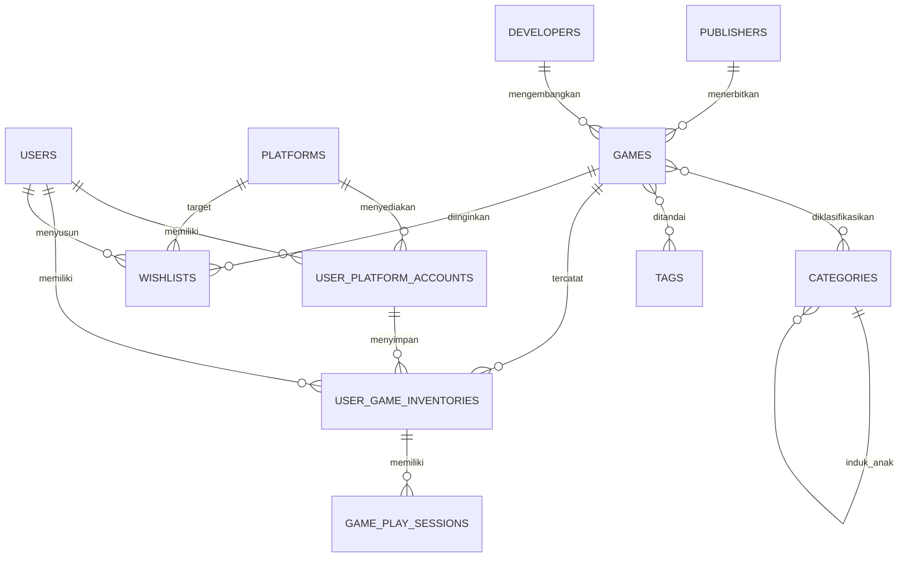

# GameVault — Merged Game Library

GameVault adalah aplikasi katalog dan manajemen inventaris game lintas platform. Tujuannya menyatukan kepemilikan, backlog, statistik waktu bermain, dan wishlist dari Steam, PlayStation, Xbox, Nintendo, GOG, serta Epic Games dalam satu dashboard.

## Fitur
- Dashboard ringkasan: jumlah koleksi, estimasi nilai berdasarkan harga perolehan, total jam bermain, dan game selesai.
- Master katalog game, publisher, developer, genre bertingkat, dan tag.
- Akun platform milik pengguna serta inventaris game digital/fisik.
- Status bermain: Unplayed, Backlog, Playing, Completed, 100% Platinum, Dropped.
- Pencarian inventaris secara reaktif, tambah/edit/hapus dengan validasi server melalui Livewire.
- Halaman detail game, kategori/tag, informasi rilis dan indikator kepemilikan ganda.
- Wishlist dengan prioritas dan target platform pada skema database.
- Eager loading relasi untuk mengurangi risiko N+1 query.
- Antarmuka dark gaming dashboard dengan komponen Blade reusable.

## Teknologi dan prasyarat
- PHP 8.2 atau lebih baru
- Composer 2
- Node.js dan npm (untuk pengembangan aset)
- MySQL 8+ atau PostgreSQL yang dikonfigurasi sesuai driver Laravel
- Laravel 11, Livewire 3, Blade, Tailwind CSS

## Instalasi lokal
1. Klon repositori:
   ```bash
   git clone https://github.com/Ishinzz2/Game-Catalog-Website.git
   cd Game-Catalog-Website
   ```
2. Pasang dependensi PHP:
   ```bash
   composer install
   ```
3. Siapkan konfigurasi:
   ```bash
   cp .env.example .env
   php artisan key:generate
   ```
4. Buat database bernama `game_catalog`, lalu sesuaikan `DB_*` pada `.env`.
5. Jalankan migrasi dan data contoh:
   ```bash
   php artisan migrate --seed
   ```
6. Jalankan aplikasi:
   ```bash
   php artisan serve
   ```
   Buka `http://127.0.0.1:8000`.

Akun contoh setelah seeding: `demo@gamevault.test` dengan kata sandi `password`. Ganti kredensial demo sebelum penggunaan nyata.

## Relasi database (ERD tekstual)


## Ringkasan tabel
| Tabel | Kegunaan |
|---|---|
| `users` | Identitas, preferensi tema, mata uang |
| `publishers`, `developers` | Master penerbit dan pengembang |
| `categories`, `tags` | Genre bertingkat dan metadata fleksibel |
| `platforms`, `user_platform_accounts` | Master platform dan akun pengguna |
| `games` | Master katalog game |
| `game_category`, `game_tag` | Pivot many-to-many |
| `user_game_inventories` | Kepemilikan per akun platform |
| `game_play_sessions` | Waktu bermain, status, rating, ulasan |
| `wishlists` | Target pembelian dan harga |

## Struktur penting
- `app/Models`: model Eloquent beserta relasi.
- `app/Livewire/InventoryManager.php`: form inventaris, validasi, dan aksi CRUD.
- `database/migrations`: skema beserta foreign key, indeks, dan soft delete.
- `database/seeders/DatabaseSeeder.php`: master platform, kategori, tag, game contoh, dan akun demo.
- `resources/views`: layout, dashboard, detail game, serta komponen kartu/statistik.
- `routes/web.php`: rute dashboard, detail, dan pengelolaan inventaris.

## Optimasi dan keamanan
Query inventaris menggunakan `with(['game.publisher','game.developer','game.categories','platformAccount.platform','playSession'])` agar relasi yang dipakai tampilan dimuat secara eager. Aksi Livewire memvalidasi input di server dan mengambil data inventaris dengan batasan `user_id` pengguna yang sedang terautentikasi. CSRF ditangani oleh middleware Laravel.

## Catatan pengembangan
Repositori ini menyediakan fondasi aplikasi dan alur dashboard/inventaris. Integrasi sinkronisasi API platform, pengelolaan akun platform lewat UI, autentikasi lengkap, fitur wishlist UI, serta pengujian otomatis perlu dilengkapi sebelum deployment produksi. Tailwind saat ini dimuat melalui CDN untuk memudahkan prototipe; untuk produksi, pindahkan ke pipeline Vite/Tailwind yang dikunci versinya.

## Conventional Commits
Gunakan awalan `feat:`, `fix:`, `refactor:`, `chore:`, dan `docs:` dengan deskripsi singkat, misalnya:
`feat: menambahkan filter status backlog pada inventaris`.
