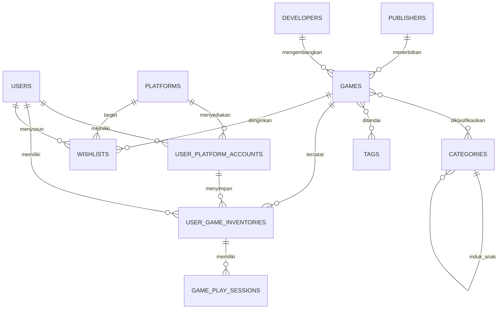

# GameVault — Merged Game Library

GameVault adalah aplikasi katalog dan manajemen inventaris game lintas platform. Tujuannya menyatukan kepemilikan, backlog, statistik waktu bermain, dan wishlist dari Steam, PlayStation, Xbox, Nintendo, GOG, serta Epic Games dalam satu dashboard.

## Fitur
- Dashboard: jumlah koleksi, estimasi nilai dari harga perolehan, total jam bermain, game selesai.
- Master game, publisher, developer, kategori hierarkis, dan tag.
- Akun platform dan inventaris game digital/fisik.
- Status: Unplayed, Backlog, Playing, Completed, 100% Platinum, Dropped.
- CRUD inventaris reaktif dengan Livewire, validasi server, pencarian instan, dan pembatasan data berdasarkan pengguna.
- Login, halaman detail game, dan indikator kepemilikan ganda.
- Wishlist interaktif: tambah/hapus item, target platform, harga maksimal, prioritas, dan catatan.
- Eager loading relasi untuk mengurangi N+1 query.
- Antarmuka dark gaming dashboard dengan komponen Blade reusable.

## Teknologi dan prasyarat
PHP 8.4.1+, Composer 2, Node.js 22.12+ dan npm, MySQL 8+ atau PostgreSQL; Laravel 13, Livewire 4, Blade, Tailwind CSS 4, dan Vite 8.

## Instalasi lokal
1. Klon repositori:
   ```bash
   git clone https://github.com/Ishinzz2/Game-Catalog-Website.git
   cd Game-Catalog-Website
   ```
2. Pasang dependensi PHP dan JavaScript:
   ```bash
   composer install
   npm install
   ```
3. Siapkan lingkungan:
   ```bash
   cp .env.example .env
   php artisan key:generate
   ```
4. Buat database `game_catalog` dan sesuaikan `DB_*` pada `.env`.
5. Jalankan migrasi dan data demo:
   ```bash
   php artisan migrate --seed
   ```
6. **Bangun aset frontend sebelum membuka aplikasi:**
   ```bash
   npm run build
   ```
   Perintah ini menghasilkan `public/build/manifest.json` yang dibutuhkan directive `@vite` di Blade. Folder hasil build tidak disimpan di Git; jalankan ulang perintah ini setelah clone atau setiap kali dependensi/aset frontend berubah.
7. Jalankan server Laravel:
   ```bash
   php artisan serve
   ```
   Untuk pengembangan frontend dengan hot reload, jalankan `npm run dev` di terminal kedua (sebagai pengganti `npm run build` selama sesi development), lalu biarkan proses Vite tetap aktif.

Akun demo seeder: `demo@gamevault.test` / `password`. Ganti kredensial demo sebelum penggunaan nyata.

## Troubleshooting Vite
Jika muncul `ViteManifestNotFoundException` atau pesan `Vite manifest not found`, pastikan dependensi Node sudah terpasang lalu jalankan `npm run build`. Jika memakai mode development, pastikan `npm run dev` masih berjalan. Jangan membuat `public/build/manifest.json` secara manual.

## ERD tekstual


## Tabel utama
| Tabel | Fungsi |
|---|---|
| users | Profil, preferensi tema, mata uang |
| publishers, developers | Master penerbit/pengembang |
| categories, tags | Genre hierarkis dan metadata |
| platforms, user_platform_accounts | Master platform dan akun pengguna |
| games | Katalog master |
| game_category, game_tag | Pivot many-to-many |
| user_game_inventories | Kepemilikan per akun platform |
| game_play_sessions | Waktu bermain, status, rating, ulasan |
| wishlists | Target pembelian, harga, prioritas |

## Struktur penting
- `app/Models`: model dan relasi Eloquent.
- `app/Livewire`: login, pengelola inventaris, dan wishlist.
- `database/migrations`: skema, foreign key, indeks, soft delete.
- `database/factories`, `database/seeders`: data uji dan data awal.
- `resources/views`: layout, dashboard, detail, komponen Blade.
- `routes/web.php`: dashboard, detail, login/logout, inventaris, dan wishlist.

## Keamanan dan optimasi
Relasi inventaris dimuat dengan `with()` untuk mengurangi N+1. Aksi Livewire memvalidasi data pada server dan mengambil item menggunakan batasan `user_id` dari pengguna terautentikasi. Area inventaris dilindungi middleware auth; Laravel menangani CSRF.

## Batasan prototipe
Sinkronisasi API Steam/PSN/Xbox/Nintendo, UI manajemen akun platform, registrasi/reset kata sandi, serta pengujian otomatis belum lengkap. Jalankan pengujian dan audit keamanan sebelum deployment.

## Conventional Commits
Gunakan `feat:`, `fix:`, `refactor:`, `chore:`, dan `docs:`, misalnya `feat: menambahkan filter status backlog`.
