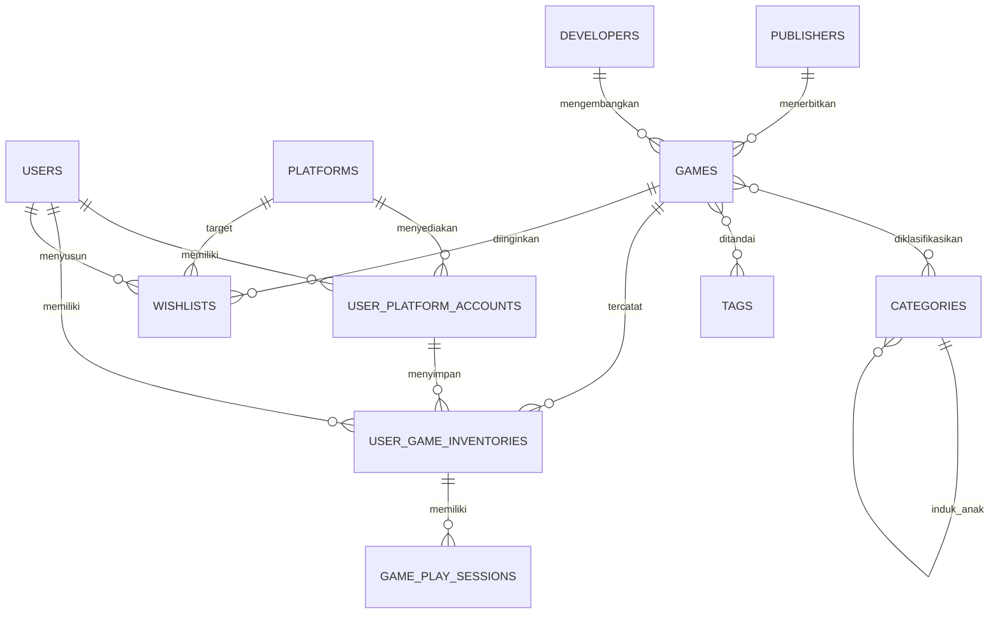

# GameVault — Merged Game Library

GameVault adalah aplikasi katalog dan manajemen inventaris game lintas platform. Tujuannya menyatukan kepemilikan, backlog, statistik waktu bermain, dan wishlist dari Steam, PlayStation, Xbox, Nintendo, GOG, serta Epic Games dalam satu dashboard.

## Fitur
- Dashboard: jumlah koleksi, estimasi nilai dari harga perolehan, total jam bermain, game selesai.
- Master game, publisher, developer, kategori hierarkis, dan tag.
- Akun platform dan inventaris game digital/fisik.
- Status: Unplayed, Backlog, Playing, Completed, 100% Platinum, Dropped.
- CRUD inventaris reaktif dengan Livewire, validasi server, pencarian instan, dan pembatasan data berdasarkan pengguna.
- Login, halaman detail game, dan indikator kepemilikan ganda.
- Wishlist dengan prioritas dan target platform pada skema database.
- Eager loading relasi untuk mengurangi N+1 query.
- Antarmuka dark gaming dashboard dengan komponen Blade reusable.

## Teknologi dan prasyarat
PHP 8.2+, Composer 2, Node.js/npm, MySQL 8+ atau PostgreSQL; Laravel 11, Livewire 3, Blade, Tailwind CSS.

## Instalasi lokal
1. Klon repositori:
   ```bash
   git clone https://github.com/Ishinzz2/Game-Catalog-Website.git
   cd Game-Catalog-Website
   ```
2. Pasang dependensi:
   ```bash
   composer install
   npm install
   ```
3. Siapkan lingkungan:
   ```bash
   cp .env.example .env
   php artisan key:generate
   ```
4. Buat database `game_catalog` dan sesuaikan `DB_*` pada `.env`.
5. Jalankan migrasi dan data demo:
   ```bash
   php artisan migrate --seed
   ```
6. Jalankan `npm run dev` dan `php artisan serve`, lalu buka `http://127.0.0.1:8000`.

Akun demo seeder: `demo@gamevault.test` / `password`. Ganti kredensial demo sebelum penggunaan nyata.

## ERD tekstual


## Tabel utama
| Tabel | Fungsi |
|---|---|
| users | Profil, preferensi tema, mata uang |
| publishers, developers | Master penerbit/pengembang |
| categories, tags | Genre hierarkis dan metadata |
| platforms, user_platform_accounts | Master platform dan akun pengguna |
| games | Katalog master |
| game_category, game_tag | Pivot many-to-many |
| user_game_inventories | Kepemilikan per akun platform |
| game_play_sessions | Waktu bermain, status, rating, ulasan |
| wishlists | Target pembelian, harga, prioritas |

## Struktur penting
- `app/Models`: model dan relasi Eloquent.
- `app/Livewire`: login dan pengelola inventaris.
- `database/migrations`: skema, foreign key, indeks, soft delete.
- `database/factories`, `database/seeders`: data uji dan data awal.
- `resources/views`: layout, dashboard, detail, komponen Blade.
- `routes/web.php`: dashboard, detail, login/logout, inventaris.

## Keamanan dan optimasi
Relasi inventaris dimuat dengan `with()` untuk mengurangi N+1. Aksi Livewire memvalidasi data pada server dan mengambil item menggunakan batasan `user_id` dari pengguna terautentikasi. Area inventaris dilindungi middleware auth; Laravel menangani CSRF.

## Batasan prototipe
Sinkronisasi API Steam/PSN/Xbox/Nintendo, UI manajemen akun platform, registrasi/reset kata sandi, UI wishlist, dan pengujian otomatis belum lengkap. Tailwind CDN digunakan untuk mempermudah prototipe; untuk produksi, gunakan pipeline Tailwind/Vite dengan versi dependensi yang dikunci. Jalankan pengujian dan audit keamanan sebelum deployment.

## Conventional Commits
Gunakan `feat:`, `fix:`, `refactor:`, `chore:`, dan `docs:`, misalnya `feat: menambahkan filter status backlog`.
