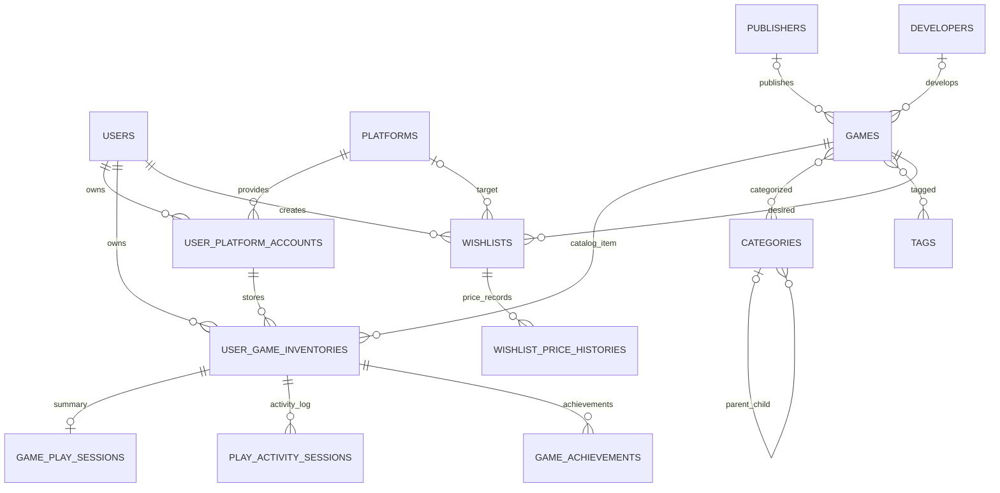

# Dokumentasi ERD GameVault

Dokumen ini merangkum struktur database dan relasi yang didefinisikan oleh migration pada repository. Skema aktual pada instalasi lama dapat berbeda sampai seluruh migration dijalankan.

## Kelompok data

1. **Akun dan otorisasi:** users menyimpan identitas akun, preferensi, dan role user atau admin.
2. **Master katalog:** games, publishers, developers, categories, dan tags.
3. **Platform dan akun:** platforms adalah daftar platform global; user_platform_accounts menyimpan akun platform yang dimiliki masing-masing pengguna.
4. **Inventaris:** user_game_inventories menghubungkan pengguna, game, dan akun platform serta menyimpan format, tipe perolehan, harga/tanggal pembelian, status instalasi, dan metadata backlog.
5. **Ringkasan bermain:** game_play_sessions menyimpan status penyelesaian, rating/review, baseline playtime manual, total playtime, dan waktu terakhir dimainkan.
6. **Aktivitas bermain:** play_activity_sessions menyimpan catatan sesi individual dengan waktu mulai, waktu selesai, durasi, dan catatan.
7. **Achievement:** game_achievements menyimpan achievement yang dicatat manual untuk item inventaris.
8. **Wishlist:** wishlists menghubungkan pengguna dengan game incaran dan platform tujuan opsional.
9. **Riwayat harga:** wishlist_price_histories menyimpan catatan harga manual untuk item wishlist.

## Relasi utama

- Satu publisher atau developer dapat terkait dengan banyak game; referensi publisher/developer pada game bersifat opsional.
- Kategori mendukung hierarki melalui categories.parent_id.
- Game dan kategori terhubung many-to-many melalui category_game; game dan tag melalui game_tag.
- Pengguna mempunyai banyak akun platform, item inventaris, dan wishlist.
- Satu platform mempunyai banyak akun pengguna dan dapat menjadi target wishlist.
- Satu akun platform dapat digunakan oleh banyak item inventaris.
- Item inventaris memiliki relasi ke game, pengguna, akun platform, ringkasan sesi bermain, log aktivitas bermain, dan achievement.
- Satu wishlist mempunyai banyak catatan riwayat harga.

## Diagram relasi

Diagram berikut menunjukkan hubungan utama. Detail kolom, constraint, dan indeks tetap mengacu pada migration.

## Tabel dan kolom penting

| Tabel | Kolom/fungsi utama |
|---|---|
| users | name, email, password, role, theme_preference, default_currency |
| publishers, developers | Nama, slug, website, negara |
| categories | Nama, slug, deskripsi, parent_id |
| tags | Nama, slug, deskripsi |
| platforms | Nama, kode, ikon, nama perusahaan |
| user_platform_accounts | user_id, platform_id, username, ID eksternal, status koneksi, waktu sinkronisasi terakhir |
| games | Judul, slug, deskripsi, cover/banner, tanggal rilis, skor Metacritic, esrb_rating |
| category_game, game_tag | Foreign key game dan kategori/tag |
| user_game_inventories | Pemilik, game, akun platform, format, tipe perolehan, harga/tanggal pembelian, instalasi, backlog |
| game_play_sessions | Status, manual_playtime_minutes, playtime_minutes, rating, review, terakhir dimainkan |
| play_activity_sessions | Inventaris, started_at, ended_at, duration_minutes, catatan |
| game_achievements | Inventaris, nama, deskripsi, waktu unlock |
| wishlists | Pengguna, game, platform tujuan, harga maksimal, prioritas, catatan |
| wishlist_price_histories | Wishlist, harga, mata uang, sumber, waktu pencatatan |

## Catatan integritas data

- Foreign key inventaris menghubungkan pengguna, game, dan akun platform. Relasi pengguna/game yang menjadi induk menggunakan cascade delete sesuai migration.
- Penghapusan platform master dibatasi oleh relasi akun platform yang masih menggunakannya.
- Referensi publisher, developer, kategori induk, dan platform target wishlist dapat dibuat nullable sesuai definisi migration.
- Tabel tertentu menggunakan soft delete; tidak semua tabel menerapkannya.
- Migration 2026_11_02_000001 menambahkan unique constraint pada game_play_sessions.user_game_inventory_id, sedangkan migration 2026_11_02_000003 kemudian menghapus unique constraint tersebut dan menambahkan index non-unique. Karena itu, jangan mengasumsikan database saat ini memaksakan satu baris ringkasan per inventaris melalui unique index.
- Model UserGameInventory menyediakan relasi playSession() dan playSessions(); alur aplikasi menggunakan playSession() sebagai ringkasan yang diperbarui.

## Evolusi skema

Migration adalah sumber kebenaran untuk skema:
- 2026_01_01_000001_create_game_library_tables.php: tabel dasar katalog, pengguna, platform, inventaris, ringkasan bermain, dan wishlist.
- 2026_11_02_000001_enforce_one_play_session_per_inventory.php: membersihkan duplikasi dan menambahkan unique index sementara.
- 2026_11_02_000002_rename_game_category_pivot_table.php: menyelaraskan nama pivot menjadi category_game.
- 2026_11_02_000003_add_activity_backlog_achievement_and_price_tracking.php: menambah data backlog, log aktivitas, achievement, dan riwayat harga; unique index sesi diganti menjadi index biasa.
- 2026_11_02_000004_add_manual_playtime_baseline.php: menambah baseline playtime manual.
- 2026_11_03_000001_add_role_to_users_table.php: menambah role pengguna.
