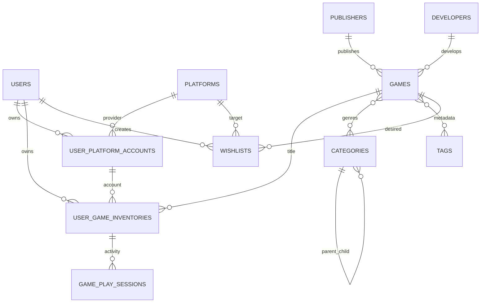

# Dokumentasi ERD GameVault

Dokumen ini menjelaskan hubungan data pada Merged Game Library.

## Kelompok data
1. **Master katalog:** `games`, `publishers`, `developers`, `categories`, dan `tags`.
2. **Platform dan akun:** `platforms` merupakan katalog platform global, sedangkan `user_platform_accounts` menyimpan akun spesifik milik pengguna.
3. **Kepemilikan:** `user_game_inventories` merepresentasikan satu kepemilikan game di satu akun platform. Satu judul dapat dimiliki beberapa kali pada platform berbeda.
4. **Aktivitas:** `game_play_sessions` menyimpan status penyelesaian, waktu bermain, rating, catatan, dan waktu terakhir dimainkan.
5. **Wishlist:** `wishlists` menghubungkan pengguna dengan game incaran dan platform tujuan.

## Relasi
- Satu publisher/developer dapat berhubungan dengan banyak game; referensi di game boleh kosong.
- Kategori mendukung hierarki melalui `categories.parent_id`.
- Game dan kategori serta game dan tag menggunakan relasi many-to-many melalui tabel pivot.
- Pengguna mempunyai banyak akun platform dan item inventaris.
- Akun platform memiliki banyak item inventaris.
- Item inventaris mempunyai riwayat sesi bermain.
- Wishlist terkait dengan pengguna, game, dan platform tujuan opsional.

## Diagram

## Integritas dan indeks
Foreign key menggunakan cascade untuk data kepemilikan yang bergantung pada pengguna/game, restrict pada penghapusan platform master yang sedang digunakan, dan null-on-delete untuk referensi master opsional. Indeks disediakan untuk judul/tanggal skor, user dan game, akun platform, status bermain, serta prioritas wishlist. Tabel utama menggunakan soft delete jika pemulihan data dibutuhkan.
